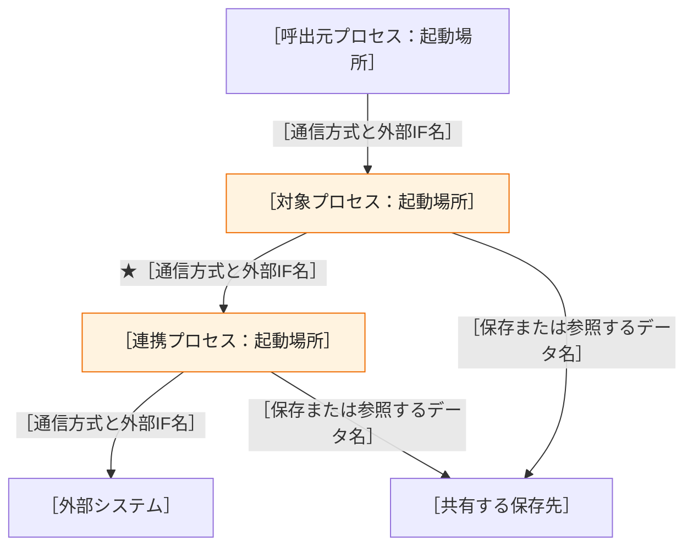
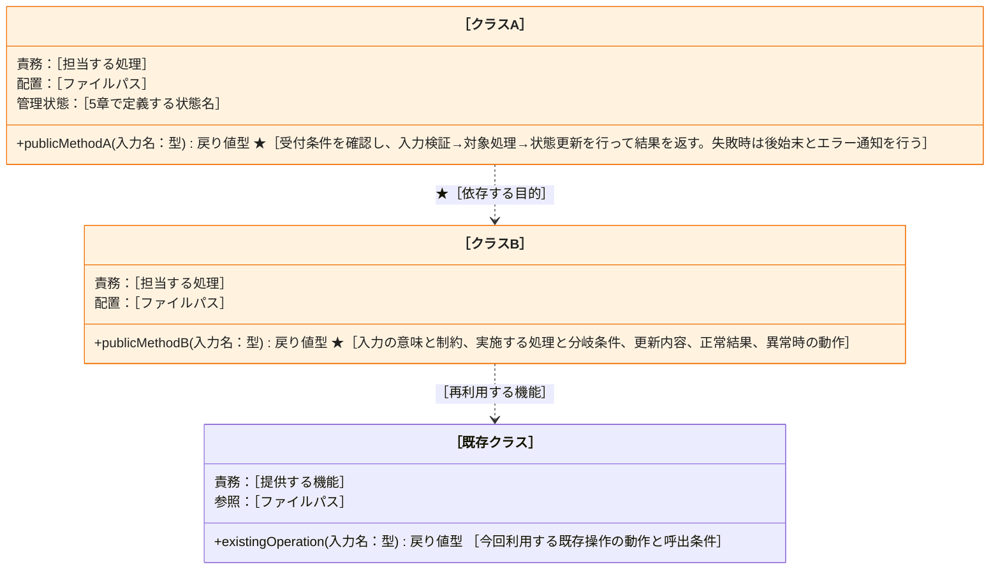
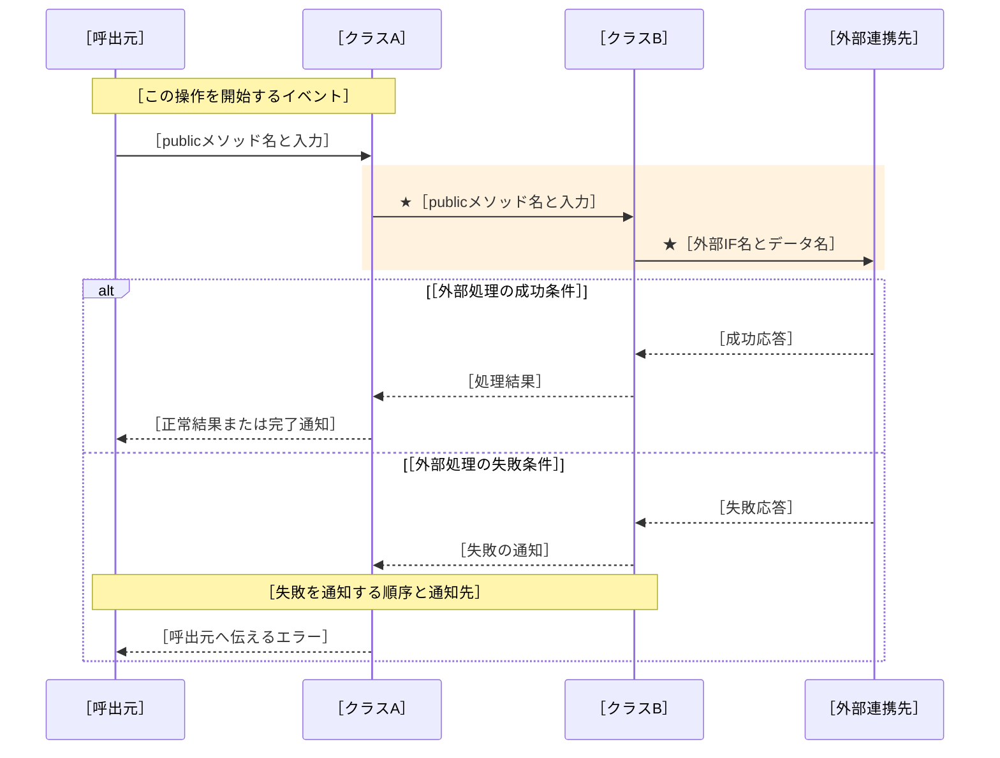
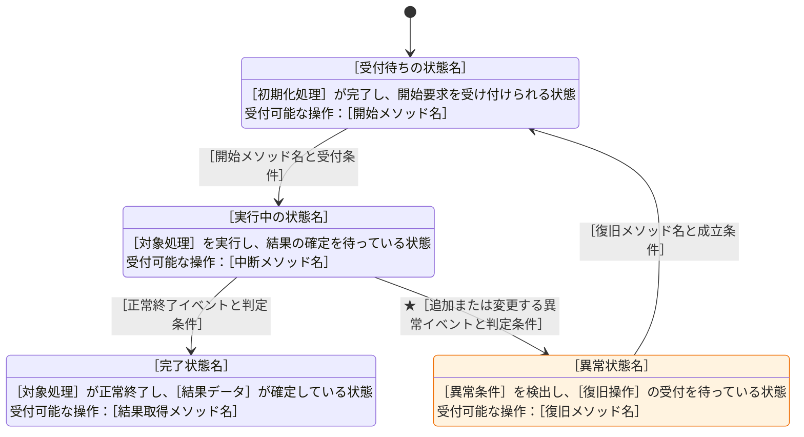

# ［機能名］コード設計書

## 1. 目的と設計範囲

［既存機能の概要、今回追加または変更する動作、利用者または呼出元が得る結果を記載する。新規開発では、実現する機能と設計範囲を記載する。］

実行環境：［言語、フレームワーク、実行プロセス］

関連要件：［要件書のパスと該当節］

上位設計：［全体設計書のパスと該当節］

既存仕様の参照先：［追加実装の基準となる仕様書の該当節、ソースのパスまたはリビジョン］

### 変更箇所の表記

追加または変更する箇所は、図のノードや区間をオレンジで示し、文章、表、メソッド、矢印のラベルには★を付ける。

## 2. 用語

**［用語］**：［この設計での意味］

## 3. 構成と動作

### 3.1 実行構成

［プロセス境界、外部システム、共有する保存先の関係を示す場合に掲載する。上位設計に定義済みの実行構成は、該当図を参照する。］

［ノードに実行単位と配置場所、接続線に通信方式または共有データを記載する。接続条件は4.2、プロセス内部のクラス構成は3.2を参照する。］

### 3.2 クラス設計

［クラス枠内の上段に責務、配置、所有する状態の名称を記載し、メソッド欄では各publicメソッドの引数と戻り値の型に続けて処理内容を説明する。関係線には依存、継承、所有などの意味を記載する。］

［各メソッドの説明には、入力の意味と制約、メソッド内の処理順序と分岐条件、更新内容、正常結果、失敗時の通知と後始末を具体的に記載する。呼出可能な状態は5章を参照する。繰返し呼出しや同時呼出しの結果も、該当するメソッド行に記載する。］

［複雑な呼出順序は3.3、状態遷移は5章、共通データは4.1を参照し、メソッド行に参照先を記載する。］

### 3.3 処理シーケンス

［複数クラスまたは外部システムが連携する操作ごとに、呼出順序、受け渡すデータ名、応答先を示す。図内の注記には待合せ、非同期通知、異常の伝播など、連携上の意味を記載する。メソッド内部の動作は3.2、データ形式は4.1、外部通信の契約は4.2を参照する。］

## 4. データと外部インターフェース

### 4.1 ［データ名］

［データの意味、生成元、利用先を説明する。共通のデータ定義は、この節から参照する。］

| 項目 | 型 | 意味 | 制約 |
| --- | --- | --- | --- |
| ★［追加または変更する項目名］ | ［型名］ | ［値が表す内容］ | ［必須性、範囲、単位、形式、欠損時の扱い］ |

［永続化するデータに相互関係がある場合は、MermaidのER図で関連と多重度を示し、データの役割を図内の注記に記載する。］

### 4.2 ［外部IF名］

［提供側と利用側、接続先の識別情報、通信または受渡し方式を定義する。入出力のデータは4.1を参照し、外部形式との対応を記載する。呼出契機と連携の順序は3.3を参照する。］

［外部応答の成功と失敗の判定基準、認証、タイムアウト、再試行の通信条件を定義する。応答を受けたメソッドの処理は3.2を参照する。］

## 5. 状態遷移

状態の所有者：［クラス名］

［各Stateの枠内に、状態名、状態の定義、受付可能な操作を記載する。状態の定義は、処理の進行状況、確定したデータ、利用可能な機能など、その状態で成立する事実を文で表す。上図の状態と操作は、対象機能の仕様に合わせて置き換える。］

［矢印には遷移の契機と成立条件を記載する。遷移に伴う具体的な更新と後始末は3.2の該当メソッドを参照する。］

## 6. 確認事項

### ［確認する内容］

［具体的な質問、確認に必要な資料または回答者、回答によって決まる設計箇所と動作を記載する。］
