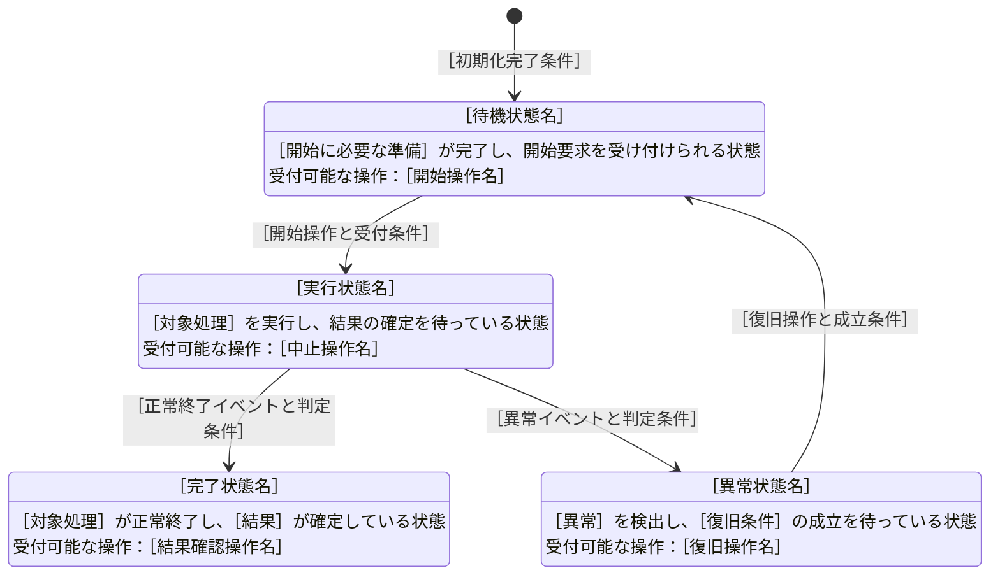

# ［機能名］機能仕様書

## 1. 目的と範囲

［誰が、何のために使い、どのような結果を得る機能かを記載する。］
［今回追加または変更する動作と、対象範囲を記載する。］

上位設計：［全体設計書のパスと該当節］
コード設計：［対応するコード設計書のパス］
既存仕様：［追加実装の基準となる資料のパスと該当節］

追加または変更する箇所は、図のノードや区間をオレンジで示し、文章、表、矢印のラベルには★を付ける。

## 2. 用語

| 用語 | この機能での意味 |
| --- | --- |
| ［用語］ | ［具体的な定義］ |

## 3. 操作と動作

### 3.1 ［操作名または自動処理名］

［操作または自動処理ごとに、この節を設ける。］

| 項目 | 仕様 |
| --- | --- |
| 実行者と契機 | ［利用者の操作、外部要求、受信イベントなど］ |
| 受付条件 | ［受け付ける状態と必要な前提。状態名は5章と対応させる］ |
| 入力 | ［入力する情報。形式と制約は4章を参照］ |
| 動作 | ［受付後から完了までの動作を順に記載］ |
| 完了条件と結果 | ［何をもって完了とし、何を表示、通知、保存するか］ |
| 受付条件を満たさない場合 | ［拒否の通知と、状態やデータの扱い］ |
| 実行中に同じ要求を受けた場合 | ［拒否、同じ結果の返却、再実行などの扱い］ |

［画面がある場合は、操作するボタン、表示項目、操作可能になる条件を記載する。］
［中止、再開、再実行などの関連操作も、それぞれ同じ形式で定義する。］

## 4. 入出力と外部インターフェース

### 4.1 ［データ名］

［データの意味、生成元、利用先を記載する。］

| 項目 | 型 | 意味 | 制約 |
| --- | --- | --- | --- |
| ［項目名］ | ［型］ | ［値が表す内容］ | ［必須性、範囲、単位、形式、省略時の扱い］ |

### 4.2 ［外部IF名］

| 項目 | 仕様 |
| --- | --- |
| 提供側と利用側 | ［要求先と呼出元、または配信元と受信先］ |
| 通信方式と接続先 | ［HTTPのメソッドとパス、ROSの種別と名前など］ |
| 要求または配信データ | ［4.1のデータ名と、通信形式との対応］ |
| 応答 | ［成功、拒否、失敗の判定条件と返却内容。応答がない方式では受信側の扱い］ |
| 通信条件 | ［認証、タイムアウト、再試行、配信周期、順序や重複の扱いを、該当するものについて記載］ |

［利用する外部IFごとに、この節を設ける。呼出契機と業務上の結果は3章を参照する。］

## 5. 状態遷移

管理対象：［この状態が表す対象］

［状態と遷移を対象機能に合わせて置き換える。各状態の枠内には、成立している事実と受付可能な操作を記載する。］

## 6. 異常時の動作

| 異常と検出条件 | 処理 | 通知先と通知内容 | 状態とデータの扱い | 復旧条件と操作 |
| --- | --- | --- | --- | --- |
| ［異常の種類と判定条件］ | ［停止、取消し、後始末など］ | ［利用者または連携先へ伝える内容］ | ［遷移先、保持または破棄するデータ］ | ［誰が何を確認し、どの操作で復旧するか］ |

［3章と4章で定義した拒否や通信失敗は、その節を参照し、機能全体に及ぶ対応を記載する。］

## 7. 確認事項

| 確認内容 | 確認先または必要な資料 | 回答によって決まる仕様 |
| --- | --- | --- |
| ［具体的な質問］ | ［回答者または資料］ | ［影響する節と動作］ |

