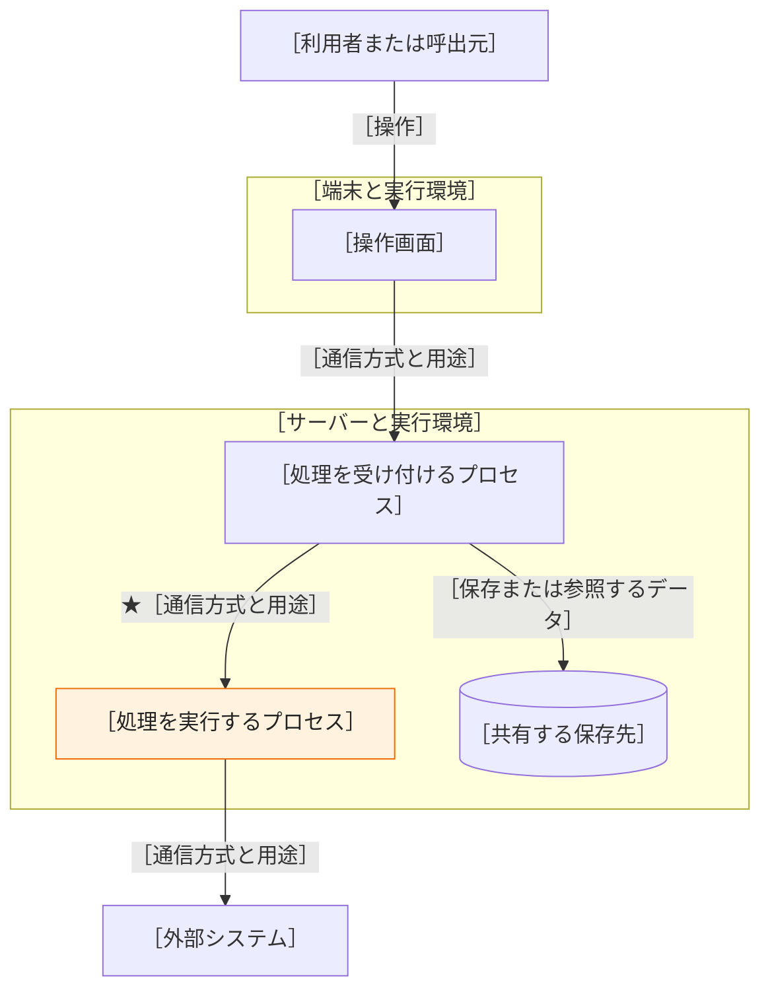
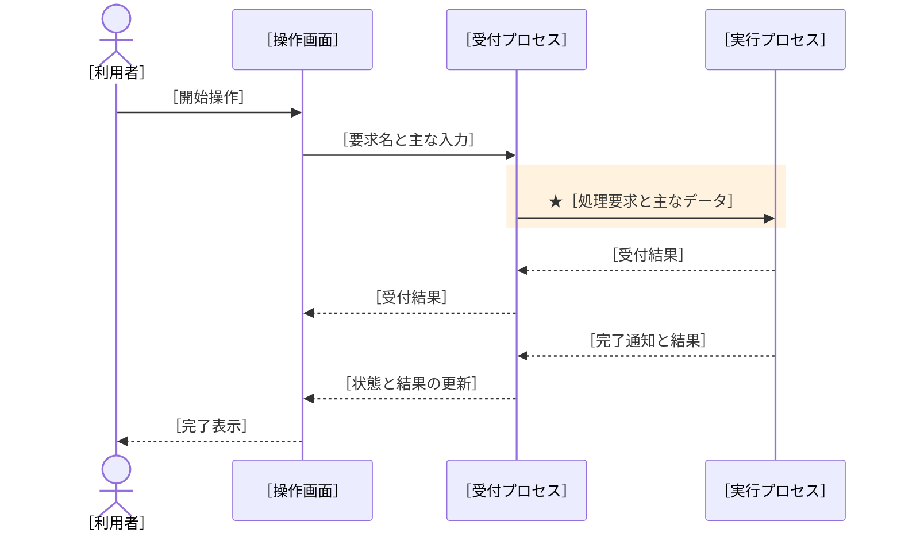
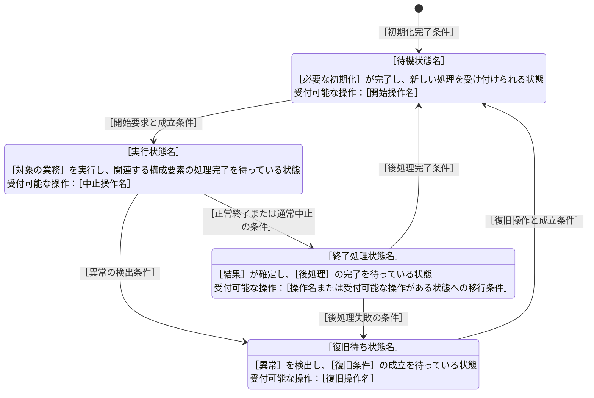

# ［システム名］全体設計書

## 1. 目的

［誰が、何のために利用し、どのような結果を得るシステムかを記載する。］
［対象とする業務と、今回追加または変更する範囲を記載する。］

前提条件：［利用環境、外部システム、運用上の制約］
関連要件：［要件を確認できる資料のパスと該当節］
既存仕様：［追加実装の基準となる資料またはソースのパスとリビジョン］

追加または変更する箇所は、図のノードや区間をオレンジで示し、文章、表、矢印のラベルには★を付ける。

## 2. システム構成

［ノードを実際の構成要素に置き換え、実行単位と配置場所を示す。接続線には通信方式と用途、または共有データを記載する。］

| 構成要素 | 責務 | 起動と終了 |
| --- | --- | --- |
| ［画面またはプロセス名］ | ［担当する処理と管理する情報］ | ［誰が、いつ起動し、いつ終了させるか］ |

［複数の構成要素で利用するデータについて、管理元と受渡し先を記載する。］

## 3. 全体の動作

### 3.1 ［一連の業務または利用場面］

［開始の契機、実行に必要な前提、完了時に得られる結果を記載する。］

［実際の連携に合わせて、同期応答、非同期通知、待合せ、人による確認を区別する。受付と処理完了の関係も明記する。］
［業務の流れが異なる場合は節を分ける。個々の操作条件とデータ形式は、6章の機能仕様書を参照する。］

## 4. 状態管理と停止・復旧

### 4.1 全体の状態

管理対象：［処理単位、セッション、システム全体など］
管理元：［状態を管理し、他の構成要素へ通知するプロセス］

［対象システムで管理する状態と遷移に置き換える。各状態の枠内には、成立している事実と受付可能な操作を記載する。］
［機能内部の状態は、対応する機能仕様書を参照する。］

### 4.2 停止と復旧の分担

| 事象 | 検出元と判断主体 | 各構成要素の処理と順序 | 状態とデータの扱い | 復旧条件と操作 |
| --- | --- | --- | --- | --- |
| ［通常完了］ | ［完了を検出し判断する構成要素］ | ［結果通知、保存、終了などの順序］ | ［遷移先と保持するデータ］ | ［次の処理を開始できる条件］ |
| ［利用者による中止］ | ［操作の受付元と判断主体］ | ［中止要求、停止、後処理の分担］ | ［途中結果と未処理要求の扱い］ | ［再実行または次の処理への移行条件］ |
| ［システム全体に影響する異常］ | ［異常の検出元と判断主体］ | ［停止対象、通知先、停止順序］ | ［遷移先と保持または破棄するデータ］ | ［確認担当者、確認内容、復旧操作］ |

［通信断、プロセス終了、タイムアウトなど、複数の構成要素に影響する事象を記載する。］

## 5. 通信の概要

| 通信元 | 通信先 | 通信方式 | IF名または接続先 | 用途と主なデータ | 定義先 |
| --- | --- | --- | --- | --- | --- |
| ［構成要素名］ | ［構成要素名］ | ［HTTP、ROS Topicなど］ | ［APIパス、Topic名など］ | ［要求、通知、受け渡す情報］ | ［機能仕様書のパスと該当節］ |

［構成図の接続に対応する通信を記載する。データ項目、応答、認証、タイムアウト、再試行の詳細は、定義先の機能仕様書を参照する。］

## 6. 関連文書

| 機能 | 担当する範囲 | 機能仕様書 | コード設計書 |
| --- | --- | --- | --- |
| ［機能名］ | ［この機能が担当する処理］ | ［文書へのリンク］ | ［文書へのリンク］ |

