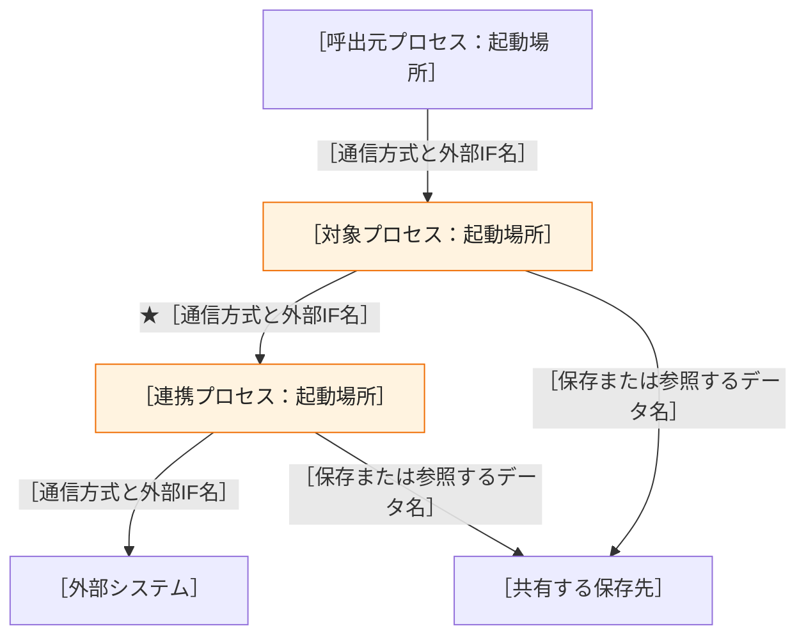
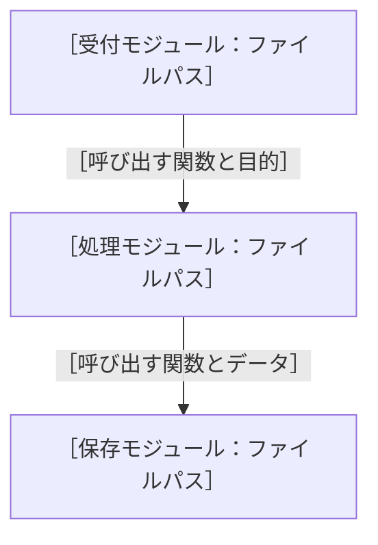
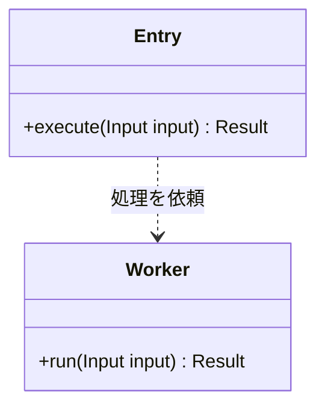
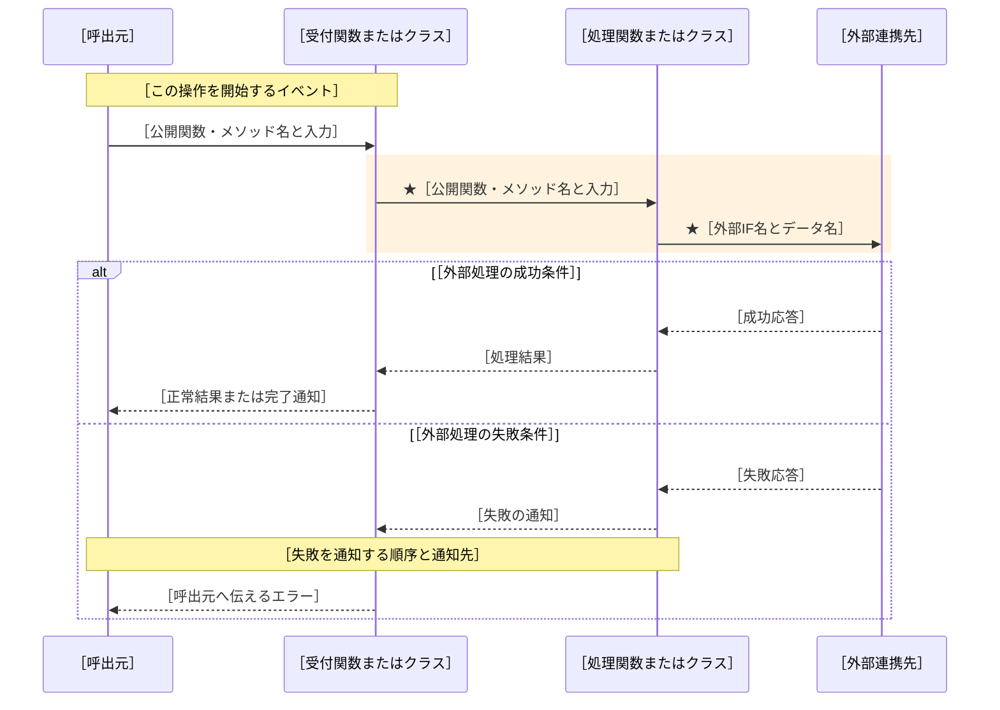
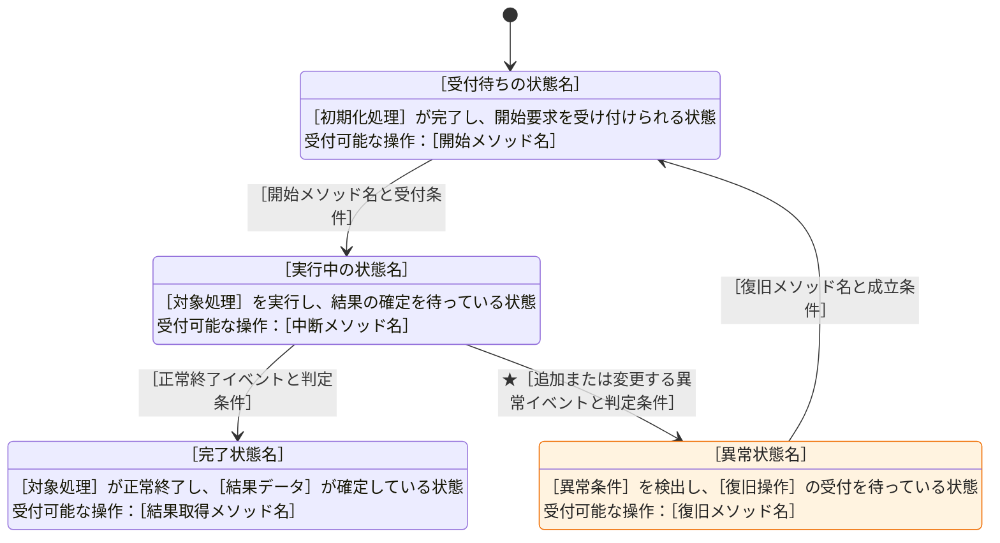

# ［機能名］コード設計書

## 1. 目的と設計範囲

［既存機能の概要、今回追加または変更する動作、利用者または呼出元が得る結果を記載する。新規開発では、実現する機能と設計範囲を記載する。］

実行環境：［言語、フレームワーク、実行プロセス］

関連要件：［要件書のパスと該当節］

上位設計：［全体設計書のパスと該当節］

機能仕様：［機能仕様書のパスと該当節］

既存仕様の参照先：［追加実装の基準となる仕様書の該当節、ソースのパスまたはリビジョン］

### 変更箇所の表記

既存改修では、基準となる仕様やリビジョンを示し、追加・変更する図のノードや区間をオレンジで示す。文章、表、関数・メソッド、矢印の変更箇所には★を付ける。新規開発では通常表記とする。

## 2. 用語

**［用語］**：［この設計での意味］

## 3. 構成と動作

### 3.1 実行構成

［プロセス境界、外部システム、共有する保存先の関係を示す場合に掲載する。上位設計に定義済みの実行構成は、該当図を参照する。］

［ノードに実行単位と配置場所、接続線に通信方式または共有データを記載する。接続条件は4.2、プロセス内部の構成は3.2を参照する。］

### 3.2 モジュール・関数・クラス設計

［対象コードの構成に合わせて関数・モジュール図、またはクラス図を選ぶ。既存コードでは、利用する公開操作の実際の名前と配置を照合する。］

関数・モジュール主体の例：

クラス主体の例：

［図には責務と依存関係の要点を示し、対象に合わせて名前・型・関係を置き換える。既存改修の変更部分はオレンジ色と★で示す。］

| ファイル・実装単位 | 責務 | 管理する状態・データ | 再利用・追加・変更 |
| --- | --- | --- | --- |
| ［パスと関数・クラス名］ | ［担当する処理］ | ［所有するデータと5章の状態］ | ［今回の扱いと変更理由］ |

#### ［公開関数またはメソッドの名前］

| 項目 | 設計 |
| --- | --- |
| 配置と呼出元 | ［ファイルパス、所属するクラス、呼出元］ |
| 入力 | ［引数名、型、意味、制約。共通定義は4.1を参照］ |
| 戻り値・完了通知 | ［型、結果の意味、同期・非同期、完了の判定方法］ |
| 受付条件 | ［呼出可能な状態と必要な前提］ |
| 処理 | ［実行順序、分岐条件、呼出先、保存・状態更新］ |
| 繰返し・同時呼出し | ［該当する場合の結果と制御方法］ |
| 失敗時の動作 | ［失敗の検出、通知先と内容、後始末、状態とデータの扱い］ |

［公開操作ごとに定義する。複雑な連携は3.3、状態は5章、入出力の共通定義は4.1を参照する。］

### 3.3 処理シーケンス

［複数の実装単位または外部システムが連携する操作ごとに、呼出順序、受け渡すデータ名、応答先を示す。図内の注記には待合せ、非同期通知、異常の伝播など、連携上の意味を記載する。関数・メソッド内部の動作は3.2、データ形式は4.1、外部通信の契約は4.2を参照する。］

## 4. データと外部インターフェース

### 4.1 ［データ名］

［機能仕様のデータ定義を参照し、内部の型との対応、生成元、利用先を説明する。実装固有のデータは、この節で定義する。］

| 項目 | 型 | 意味 | 制約 |
| --- | --- | --- | --- |
| ★［追加または変更する項目名］ | ［型名］ | ［値が表す内容］ | ［必須性、範囲、単位、形式、欠損時の扱い］ |

［永続化するデータに相互関係がある場合は、MermaidのER図で関連と多重度を示し、データの役割を図内の注記に記載する。］

### 4.2 ［外部IF名］

［機能仕様書の外部IF定義を参照する。接続設定の配置、担当する関数、外部形式と4.1の内部データとの変換を記載する。呼出契機と連携の順序は3.3、成功・拒否・失敗に応じた実装側の処理は3.2を参照する。］

## 5. 状態遷移

状態の所有者：［モジュール、関数の呼出元、クラスなど］

［各Stateの枠内に、状態名、状態の定義、受付可能な操作を記載する。状態の定義は、処理の進行状況、確定したデータ、利用可能な機能など、その状態で成立する事実を文で表す。上図の状態と操作は、対象機能の仕様に合わせて置き換える。］

［矢印には遷移の契機と成立条件を記載する。遷移に伴う具体的な更新と後始末は3.2の該当関数・メソッドを参照する。］

## 6. 設計判断と前提

| 判断する事項 | 採用案と理由 | 前提と影響範囲 |
| --- | --- | --- |
| ［責務分担、並行処理、保存方法など］ | ［要件と既存構成に基づく判断］ | ［成立条件と呼出元への影響］ |

## 7. 実装後の検証観点

| 要件・機能仕様の定義先 | 担当するファイル・関数 | 入力・操作・条件 | 期待結果 |
| --- | --- | --- | --- |
| ［要件と動作の参照先］ | ［確認対象］ | ［正常、拒否、競合、途中失敗などの具体的な場面］ | ［戻り値、通知、状態、保存データ］ |

［設計上で利用場面をたどった結果を記載する。試作やテストを実行した場合は、対象リビジョン、コマンド、実行結果を別に記録する。］

## 8. 確認事項

### ［確認する内容］

［具体的な質問、確認に必要な資料または回答者、回答によって決まる設計箇所と動作を記載する。］
